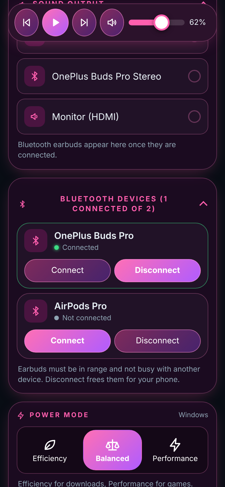

# RemotePc

**Control your Windows PC from your phone.** Lock it, put the screen off, restart it, open Steam and start a game, change the volume and sound output, connect your earbuds, open apps, and more. Three steps to install, one QR code to pair. No account with us, no cloud, no subscription.

<p>



</p>

## What you need

A **Windows 10 or 11 PC**, an **iPhone or Android phone**, and a **Google account**. About 10 minutes.

## Install easily in 3 steps

> [!NOTE]
> ### 🟦 Step 1: Tailscale on your phone and laptop
> Install **Tailscale** on both ([tailscale.com/download](https://tailscale.com/download)). Sign in with the **same Google account**. Check it says **Connected**.

> [!TIP]
> ### 🟩 Step 2: Run the command on the laptop
> Open any folder, click the **address bar**, type `powershell`, press **Enter**. Paste and press **Enter**:
>
> ```powershell
> irm https://raw.githubusercontent.com/Aswinksanthosh/RemotePc/main/install.ps1 | iex
> ```
>
> Click **Yes** when Windows asks. A **QR code** appears.

> [!IMPORTANT]
> ### 🟪 Step 3: Scan the QR code with the phone
> Scan with the **Camera** app and tap the link. Then **Add to Home Screen** (iPhone: Share. Android: menu). Press **Enter** on the laptop. Done.

> [!WARNING]
> The QR link is the key to your laptop: never share it. Lost a phone? Run **Pair-Phone**.

*Phone pictures are a preview with pretend data. The installer prints where your files are (`C:\Users\<you>\.remortstartpc`).*

## What the buttons do

| Button | What it does |
|---|---|
| Power menu (power icon, top right) and the Power card | Lock, Screen off, Sleep, Restart, Turn off, Cancel turn off. Sleep, Restart and Turn off ask "are you sure?" first |
| Steam | Open Steam, Big Picture, pick one of your installed games and start it, close the running game, switch Steam account. Every game is started from this drop-down only. Starting asks first |
| Sound output | Choose where the sound plays (speakers, headphones, monitor) |
| Bluetooth devices (drop-down) | Connect or disconnect a paired Bluetooth device (earbuds) on this PC, so it is free for your phone or another PC |
| Media | Previous, play/pause, next, volume up/down, mute |
| Power mode | Efficiency, Balanced or Performance (Windows) |
| Apps (drop-down) | **Spotify** (if installed) plus any apps you add **on the PC**. Opening an app asks first |
| My buttons | Your own buttons that run a command you wrote (optional, see [docs/CUSTOMIZE.md](docs/CUSTOMIZE.md)) |
| Theme | Pick one of three looks (Neon, Tactical, Clean). Several PCs? A swipe card above Steam moves between them |
| Settings (cog, top right) | Start with Windows, Steam Big Picture at startup, power mode at startup, temperature limit, name, theme, PIN, home Wi-Fi access |
| System | PC status (battery, graphics card, uptime) and **Update App** (updates, restarts by itself and refreshes the page) |

Risky buttons ask first, and a few need a short hold. Nothing you type on the phone is ever run as a command: the phone can only press buttons that exist. **A phone can never add or remove apps**; that is only possible on the PC itself, so a lost phone cannot open a sensitive app.

**Updates:** every time the PC starts, the program checks for a newer version. If there is one, the phone page asks **"A new version is ready. Update now?"** once per start (Yes, update / Cancel).

## Starting the PC when it is turned off

Be honest with yourself about this one: **a PC that is completely off cannot answer anything**, so no app on the PC can turn it on. Your options, from easiest to hardest, are in **[docs/START-FROM-OFF.md](docs/START-FROM-OFF.md)**. The short version:

1. **Do not turn it off.** Use **Lock** and **Screen off** instead of Sleep or Turn off. Easiest, and it just works.
2. **Wake-on-LAN** with a small always-on helper (a second PC, or a Raspberry Pi). Needs the PC on a **network cable**. Run **Wake-on-LAN-Setup** on the PC, the guide does the rest.
3. A **smart plug** with the BIOS option "power on after power loss" (desktops mostly).

## Share it with a friend

Send them this repository link and this message:

> Open the link and follow "Install". It takes about 10 minutes. You need a Windows PC, your phone, and a Google account. First install the Tailscale app on your phone and sign in with Google, then run the installer on the PC.

Everyone installs on their own PC and pairs their own phone. Nothing is shared between you.

## Everyday things

| I want to... | Do this |
|---|---|
| Add, change or remove a PIN (optional, extra safety if someone else may hold your phone) | Double-click **Set-PIN** (also in the Start menu) |
| Pair another phone | Double-click **Pair-Phone** (also in the Start menu), scan the new code |
| Update to the newest version | Press **Update App** on the phone page (System), or double-click **Update** |
| Something does not work | Double-click **Fix-It**. It checks everything and tells you what to do |
| Remove it | Double-click **Uninstall** |
| Add my own buttons or apps (apps are added on the PC) | [docs/CUSTOMIZE.md](docs/CUSTOMIZE.md) |
| Change the colour or the name on the page | [docs/CUSTOMIZE.md](docs/CUSTOMIZE.md) |

The **Pair-Phone**, **Fix-It**, **Update** and **Uninstall** shortcuts are in the Start menu under *RemortStartPc* after the install.

## Is it safe?

- **Nothing is opened to the internet.** Your phone talks to your PC through Tailscale (encrypted, private to your own devices). The program refuses every connection that does not come from your own devices.
- **A key, and an optional PIN.** Each phone holds a long random key (in the link of the QR code). You can also add a PIN, which the phone then asks for. The PC stores only a fingerprint of the key and a salted hash of the PIN. Five wrong PINs lock that device out for five minutes. You can forget any phone at any time.
- **Fixed buttons only.** The phone can only ask for the actions in a fixed list. It cannot run commands, read files or type on the PC.
- **No accounts, no tracking.** Your phone and PC talk directly. The only thing that goes out is the update check (to GitHub) when you press Update.

Details, and what it does *not* protect against: **[docs/SECURITY.md](docs/SECURITY.md)**.

## When something goes wrong

Double-click **Fix-It** first. The most common problems:

- **"Cannot reach the PC"** on the phone: the PC is asleep or off, or Tailscale is off on the phone.
- **The QR code opens a page that says "pair again"**: the phone was forgotten, or you scanned an old code. Run **Pair-Phone**.
- **Installer stops at Tailscale**: install it by hand from tailscale.com/download, sign in, run the installer again (it is safe to repeat).

More in **[docs/TROUBLESHOOTING.md](docs/TROUBLESHOOTING.md)**.

## For the curious

How it works, the files, how to run the tests: [docs/HOW-IT-WORKS.md](docs/HOW-IT-WORKS.md). There are no dependencies to install: it is plain Node.js. The tests run with `node --test`.

## Settings on the PC itself

Double-click the **RemotePc Settings** shortcut (cog icon) on the Desktop, or **Settings** in the Start menu. It opens the Settings page in a browser **on the PC**. No phone needed, no pairing key; if you set a PIN it asks for it. Only here you can:

- **Add a phone** (it shows a new QR code).
- **Add apps** to the phone's Apps list: search the apps on the PC and press Add, or drop an app's shortcut on the box. Games are not added here: they live in the Steam drop-down.
- Press **Update App**, **Fix-It** or **Uninstall**, and set the **temperature limiter**.

## Temperature limiter (optional)

Switch it on in Settings and choose a CPU limit and a graphics card limit in degrees. Below the limits nothing is restricted and the CPU and graphics card boost as usual. Above a limit the speed is lowered a little at a time until it is cool again. A laptop starts at 70, a handheld (ROG Ally) at 90. It needs administrator rights **once, at install time**; run the installer again to add it to an existing install. Read **[docs/SECURITY.md](docs/SECURITY.md)** and the notes in [docs/CUSTOMIZE.md](docs/CUSTOMIZE.md) first: reading the CPU temperature is not exact on every PC, so use **Check temperature sensors** and compare with another monitor.

## Ideas, feedback, bugs

On the page, open the **Ideas, feedback or a bug?** drop-down at the bottom and choose what you want to send. It opens a short form on GitHub. Or open an issue here directly. Please never paste your pairing link, PIN or password.

## Credits and licence

© 2026 Aswin K Santhosh. MIT licence, see [LICENSE](LICENSE). Parts of the remote were first written for the Jarvis project (MIT, by Aditya Dewaskar). The QR code generator is by Kazuhiko Arase (MIT), see [THIRD-PARTY.md](THIRD-PARTY.md). "QR Code" is a registered trademark of DENSO WAVE INCORPORATED. Steam is a trademark of Valve; this project is not affiliated with Valve, Tailscale or Microsoft.
