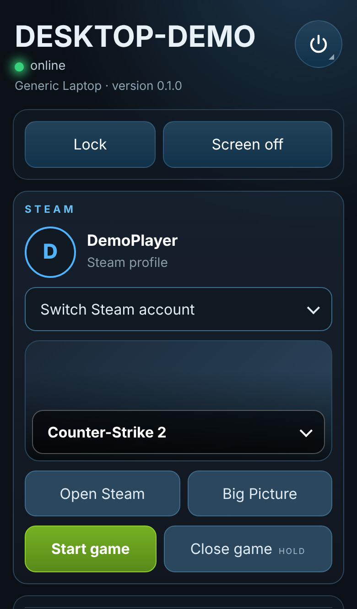
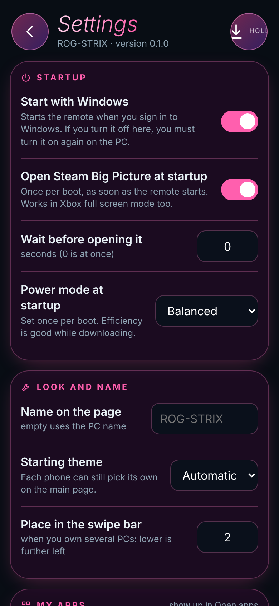

# RemotePc

**Control your Windows PC from your phone.** Lock it, put the screen off, restart it, open Steam and start a game, change the volume and sound output, connect your earbuds, open apps, and more. Three steps to install, one QR code to pair. No account with us, no cloud, no subscription.

<p>



</p>

## What you need

A **Windows 10 or 11 PC**, an **iPhone or Android phone**, and a **Google account**. About 10 minutes.

## Install easily in 3 steps

> [!NOTE]
> ### 🟦 Step 1: Tailscale on your phone and laptop
> Install **Tailscale** on both ([tailscale.com/download](https://tailscale.com/download)). Sign in with the **same Google account**. Check it says **Connected**.

> [!TIP]
> ### 🟩 Step 2: Run the command on the laptop
> Press the **Windows key**, type `powershell`, press **Enter**. Paste this and press **Enter**:
>
> ```powershell
> irm https://raw.githubusercontent.com/Aswinksanthosh/RemotePc/main/install.ps1 | iex
> ```
>
> Click **Yes** when Windows asks. A **QR code** appears.

> [!IMPORTANT]
> ### 🟪 Step 3: Scan the QR code with the phone
> The QR code is the **link that opens the remote page** on your phone. It only opens while the phone's **Tailscale app is Connected, signed in with the same Google account** as the laptop.
> Scan it with the **Camera** app and tap the link. Then **Add to Home Screen** (iPhone: Share. Android: menu). Press **Enter** on the laptop. Done.

> [!WARNING]
> The QR link is the key to your laptop: never share it or a picture of it. Lost a phone? Forget it on the page (Paired phones). To add another phone, use **Settings**, then **Add a phone**, from any paired phone, or run **Pair-Phone** on the laptop.

*Phone pictures are a preview with pretend data. The installer prints where your files are (`C:\Users\<you>\.remortstartpc`).*

## Add your applications

Double-click the **RemotePc Settings** shortcut (cog icon) on the Desktop. In **My apps**, search for the app and press **Add**, or drop its shortcut on the box. It then shows in the **Apps** list on your phone.

## Is it safe?

- **Nothing is opened to the internet.** Your phone talks to your PC through Tailscale (encrypted, private to your own devices). The program refuses every connection that does not come from your own devices.
- **A key, and an optional PIN.** Each phone holds a long random key (in the link of the QR code). You can also add a PIN, which the phone then asks for. The PC stores only a fingerprint of the key and a salted hash of the PIN. Five wrong PINs lock that device out for five minutes. You can forget any phone at any time.
- **Fixed buttons only.** The phone can only ask for the actions in a fixed list. It cannot run commands, read files or type on the PC.
- **No accounts, no tracking.** Your phone and PC talk directly. The only thing that goes out is the update check (to GitHub) when you press Update.

Details, and what it does *not* protect against: **[docs/SECURITY.md](docs/SECURITY.md)**.

## When something goes wrong

Double-click **Fix-It** first. The most common problems:

- **"Cannot reach the PC"** on the phone: the PC is asleep or off, or Tailscale is off on the phone.
- **The QR code opens a page that says "pair again"**: the phone was forgotten, or you scanned an old code. Run **Pair-Phone**.
- **Installer stops at Tailscale**: install it by hand from tailscale.com/download, sign in, run the installer again (it is safe to repeat).

More in **[docs/TROUBLESHOOTING.md](docs/TROUBLESHOOTING.md)**.

## For the curious

How it works, the files, how to run the tests: [docs/HOW-IT-WORKS.md](docs/HOW-IT-WORKS.md). There are no dependencies to install: it is plain Node.js. The tests run with `node --test`.

## Ideas, feedback, bugs

On the page, open the **Ideas, feedback or a bug?** drop-down at the bottom and choose what you want to send. It opens a short form on GitHub. Or open an issue here directly. Please never paste your pairing link, PIN or password.

## Credits and licence

© 2026 Aswin K Santhosh. MIT licence, see [LICENSE](LICENSE). Parts of the remote were first written for the Jarvis project (MIT, by Aditya Dewaskar). The QR code generator is by Kazuhiko Arase (MIT), see [THIRD-PARTY.md](THIRD-PARTY.md). "QR Code" is a registered trademark of DENSO WAVE INCORPORATED. Steam is a trademark of Valve; this project is not affiliated with Valve, Tailscale or Microsoft.
